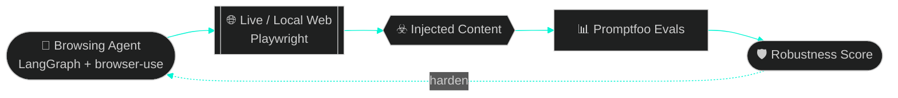

<div align="center">


<a href="https://github.com/ramiwalid">
  
</a>

<br/>


</div>

---

## `// 01 — OPERATOR_PROFILE`

<table>
<tr>
<td width="58%">

```yaml
operator:   Rami Walid
role:       Software Engineer · AI Security Researcher
university: New Jersey Institute of Technology
degree:     B.S. Computer Science, Minor Applied Statistics
grad:       May 2027
honors:     2x NSF Scholar
focus:      [ agentic AI, prompt injection, secure systems ]
status:     ● ONLINE
```

</td>
<td width="42%">

```text
┌────────────────────────────────┐
│  AI SECURITY   ██████████████  │
│  BACKEND       █████████████░  │
│  FULL-STACK    ████████████░░  │
│  DEVOPS / CICD ███████████░░░  │
│  COFFEE        ██████████████  │
└────────────────────────────────┘
```

</td>
</tr>
</table>

---

## `// 02 — ACTIVE_MISSION: RED-TEAMING AI AGENTS`

> **Undergraduate Researcher, AI Security & Agentic Systems** · NJIT Ying Wu College of Computing · *Sep 2026 – Present*

I'm building a fully agentic evaluation framework to study **indirect prompt injection** in web-browsing AI agents: what happens when an autonomous agent reads a page that's been weaponized against it.



- 🔴 Automated **red-teaming pipelines** that send agents into live and local environments to measure susceptibility to adversarial content
- 🧪 **Reproducible test harnesses** (Promptfoo) to benchmark agent robustness across deployment conditions
- 🧰 `Python` · `LangGraph` · `Playwright` · `browser-use` · `Promptfoo`

---

## `// 03 — MISSION_LOG`

<details open>
<summary><b>🏦 Software Engineer Intern @ Fiserv</b> — TransArmor team · <i>Jun – Aug 2026</i></summary>
<br/>

Worked on the team that encrypts and secures **300M–400M payment transactions per day** for some of the world's largest merchants.

| Built | Impact |
|:--|:--|
| 🤖 **AI-agent vulnerability remediation tool** (Java, Spring Boot, Maven) wired into Fortify, Jira & GitLab | Ingests scans, assigns remediation dates, opens tickets, and applies **real code fixes** across **12 core apps** |
| 🔁 **End-to-end auto-remediation** with agents submitting GitLab merge requests | Security compliance gaps cut from **weeks to hours** |
| ⚙️ **CI/CD + DevOps automation** via Harness | Deploy time down **85%**, saving **~20 hrs/week** |
| 📉 Compliance-grade rollout in a strict **PCI DSS** environment | Projected **80% less manual effort** |

</details>

<details>
<summary><b>🧮 Undergraduate Researcher, Java Developer @ NJIT</b> — <i>Jan – May 2026</i></summary>
<br/>

- Deployed an **AWS EC2-hosted Java app** giving NJIT students and faculty department-wide access to a math extraction engine
- Built the engine to **parse complex equations from source documents**, cutting manual analysis time by **90%+**
- Refactored the automated test suite for better coverage and reliability, with fewer regressions for downstream users

</details>

---

## `// 04 — FEATURED_BUILD`

### 💳 Credit Card Aggregator &nbsp;·&nbsp; *Nov 2025 – Present*

A full-stack finance platform that pulls multi-institution credit card data into one unified dashboard.

```text
 ┌──────────────┐    OAuth2     ┌──────────────┐    SQL    ┌──────────────┐
 │ Next.js/React│ ───────────▶  │   FastAPI    │ ───────▶  │  PostgreSQL  │
 │  + Tailwind  │ ◀───────────  │ tokenized    │ ◀───────  │  normalized  │
 └──────────────┘   dashboards  │  pipelines   │           └──────────────┘
                                └──────────────┘
```

- 🔐 Secure FastAPI backend with **OAuth2 authorization** and tokenized data pipelines
- 🗄️ Normalized PostgreSQL schema for seamless multi-source aggregation
- 📈 Visualizes balance, credit utilization and payment dates, with **25% fewer re-renders** from optimized React components

`Next.js` `TypeScript` `React` `Tailwind` `FastAPI` `PostgreSQL`

---

## `// 05 — LOADOUT`

<div align="center">


<br/>


</div>

| Layer | Tools |
|:--|:--|
| **Languages** | Python · Java · C/C++ · SQL · JavaScript · TypeScript · Swift · HTML/CSS |
| **AI / ML & Agents** | LangGraph · Promptfoo · Playwright · browser-use · LLM Agents · Pandas |
| **Web** | React · Next.js · Node.js · FastAPI · Flask · Vue.js · Spring Boot · Tailwind |
| **Cloud & DevOps** | AWS (EC2) · Google Cloud · Docker · Git · CI/CD · Harness · GitLab · Linux/Bash |
| **Security** | AI Security · Prompt Injection · Red-Teaming · PCI DSS-aware engineering |
| **Coursework** | Advanced DSA · Linux Programming in C · Advanced Databases · Computer Architecture · Operating Systems |

---

## `// 06 — TELEMETRY`

<div align="center">


</div>

---

## `// 07 — OPEN_CHANNELS`

<div align="center">

[](https://linkedin.com/in/ramiwalid)
[](mailto:ramiwalid5@pm.me)
[](https://github.com/ramiwalid)

<br/>

```text
$ ping rami --collab
64 bytes from rami: time=1ms  status=READY_TO_BUILD
```

<sub>ACM @ NJIT · open to AI security, agentic systems & backend roles</sub>


</div>
