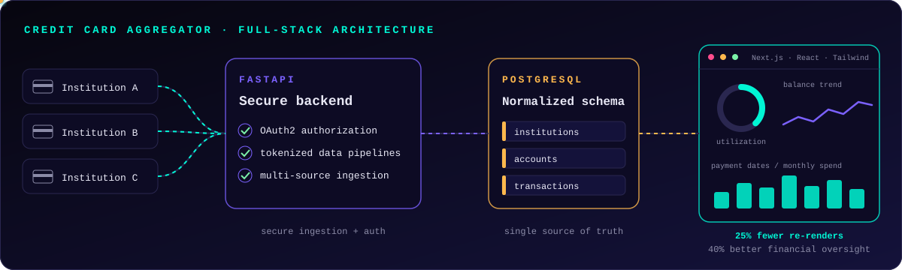

<!--
  Rami Walid · GitHub profile README
  Needs the /assets folder next to this file (repo: ramiwalid/ramiwalid).
  Visuals are hand-built animated SVGs, so they work on GitHub with no external services.
-->

  

  
  
  

 

### Red-teaming AI agents that browse the web

I'm an undergraduate researcher at NJIT's Ying Wu College of Computing studying **indirect prompt injection**: what happens when an autonomous agent reads a web page that was written to hijack it. I'm building a fully agentic evaluation framework that deploys agents into live and local environments and measures how they hold up against adversarial content.

- **Automated red-teaming:** pipelines that send agents out to browse and systematically test their susceptibility to injected instructions
- **Reproducible benchmarks:** Promptfoo evaluation suites that score agent robustness across deployment conditions
- **Stack:** `Python` · `LangGraph` · `Playwright` · `browser-use` · `Promptfoo`

 

At **Fiserv**, on the TransArmor team that secures payments for the world's largest merchants, I built an AI-agent vulnerability remediation tool (`Java` · `Spring Boot` · `Maven`) that connects **Fortify, Jira and GitLab**. It ingests security scans, assigns remediation dates, files tickets, applies real code fixes and opens merge requests, all inside a strict **PCI DSS** environment.

 

<b>AI Security & Agentic Systems Researcher</b> · NJIT Ying Wu College of Computing · <i>Sep 2026 – present</i>

 

- Architecting an agentic evaluation framework (`Python`, `LangGraph`, `Playwright`, `browser-use`, `Promptfoo`) to study indirect prompt injection in web-browsing agents
- Designing red-teaming pipelines that deploy agents to live and local environments to evaluate how they respond to adversarial content during autonomous navigation
- Building reproducible test harnesses and evaluation suites to benchmark robustness against injected or malicious content

<b>Software Engineer Intern</b> · Fiserv, TransArmor team · <i>Jun – Aug 2026</i>

 

- Worked on the team that encrypts and secures **300M–400M payment transactions per day**
- Built an **AI-agent vulnerability remediation tool** integrating Fortify, Jira and GitLab, applying real fixes across **12 core applications**
- Agents apply fixes and submit GitLab merge requests end to end, cutting security compliance gaps **from weeks to hours**
- Automated CI/CD and DevOps workflows with Harness: **85% faster deployments**, saving **20 hours/week**
- Projected **80% reduction in manual effort**, reclaiming **1,152 developer hours** and **108 manager hours** annually

<b>Undergraduate Researcher, Java Developer</b> · NJIT Ying Wu College of Computing · <i>Jan – May 2026</i>

 

- Deployed an **AWS EC2-hosted Java app** giving students and faculty department-wide access to a mathematical extraction engine
- Built the engine to identify and parse complex equations from source documents, cutting manual analysis by **90%+**
- Refactored the automated test suite to improve coverage and reliability, reducing regressions for downstream users

 

### Credit Card Aggregator &nbsp;·&nbsp; Nov 2025 – present

A full-stack finance platform that consolidates credit card data from multiple institutions into one dashboard.

- **Backend:** secure `FastAPI` service with OAuth2 authorization and tokenized data pipelines
- **Data:** normalized `PostgreSQL` schema built for seamless multi-source aggregation
- **Frontend:** `Next.js` + `React` + `Tailwind` charts for balance, credit utilization and payment dates, with **25% fewer re-renders** after optimization

 

| | |
|:--|:--|
| **Languages** | Python · Java · C/C++ · SQL · JavaScript · TypeScript · HTML/CSS · Swift |
| **AI & agents** | LangGraph · Promptfoo · Playwright · browser-use · LLM agents · Pandas |
| **Web** | React · Next.js · Node.js · FastAPI · Flask · Vue.js · Spring Boot · Tailwind · Bootstrap |
| **Cloud & DevOps** | AWS (EC2) · Google Cloud · Docker · Git · CI/CD · Harness · GitLab · Linux/Bash |
| **Security** | AI security · prompt injection · red-teaming · PCI DSS-aware engineering |
| **Coursework** | Advanced Data Structures & Algorithms · Linux Programming in C · Advanced Databases · Computer Architecture · Operating Systems |

B.S. Computer Science, minor in Applied Statistics · New Jersey Institute of Technology · expected May 2027 · 2x NSF Scholar · ACM @ NJIT

 

  
  

  

 

  
  
  

